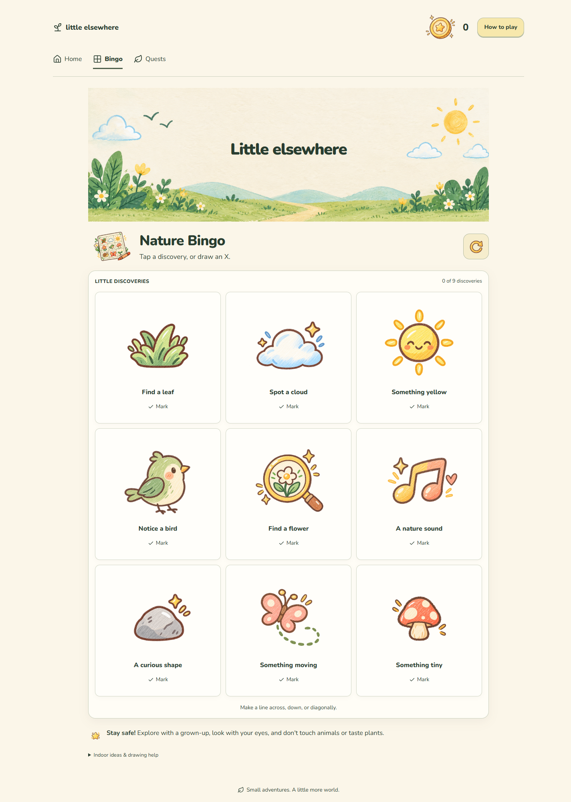
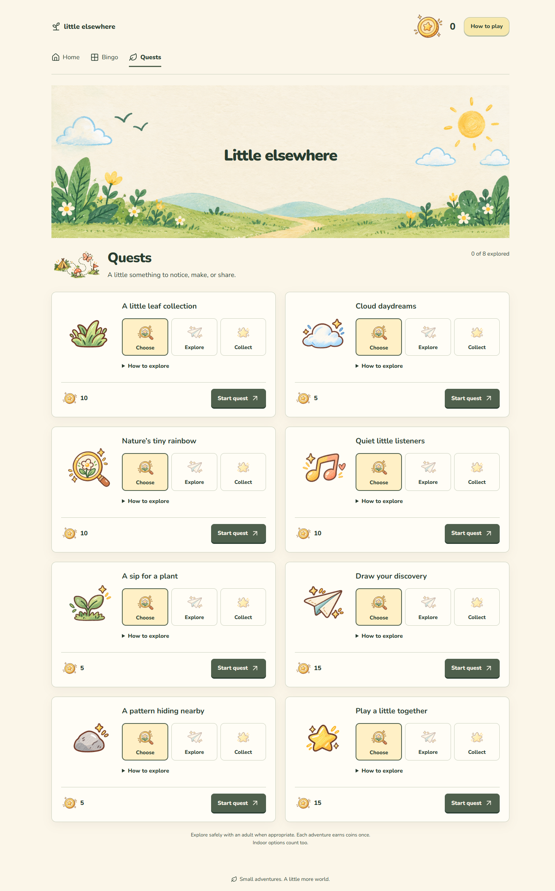
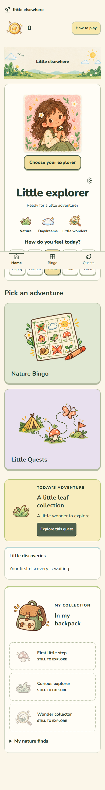
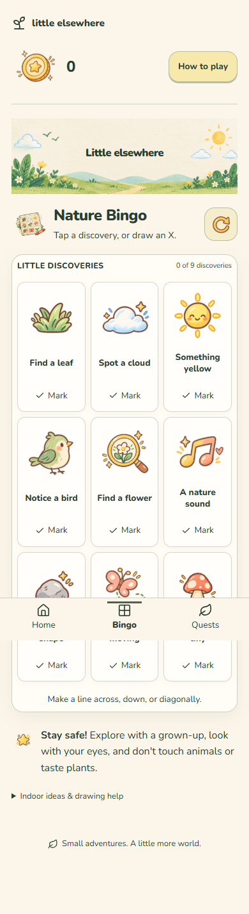
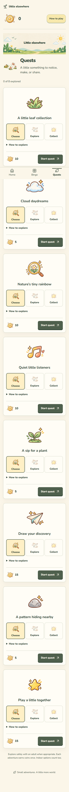

<h1 align="center">Little Elsewhere</h1>

<p align="center"><strong>Small adventures. A little more world.</strong></p>
<p align="center">A children's outdoor adventure journal, made for time away from the screen.</p>

<p align="center">
  <a href="#a-peek-inside">Screenshots</a> &middot;
  <a href="#what-works-today">Features</a> &middot;
  <a href="#run-it-locally">Get started</a> &middot;
  <a href="#where-i-want-to-take-it">Future plans</a>
</p>

<p align="center">
  
</p>

## Why Little Elsewhere?

I wanted to make putting a screen down feel like the beginning of something good. A cloud worth noticing. A plant to care for. A small discovery to bring back.

Little Elsewhere gives children a gentle prompt, then a place to record what they explored. Its warm paper surfaces, original illustrations, and scrapbook details make it feel like a personal adventure journal. There are no streak penalties or pressure to keep playing.

**Choose an adventure. Put the device away. Explore. Come back with a discovery.**

## What works today

| Part of the journal | What children can do |
| --- | --- |
| **My explorer** | Choose from six portraits, pick a mood, and optionally save a name and age. |
| **Nature Bingo** | Find nine little wonders. Draw an X or use Mark, undo a discovery, and start a fresh board. |
| **Little Quests** | Explore eight activities with a Choose / Explore / Collect trail, directions, and indoor or adapted alternatives. |
| **Coins** | Collect rewards for a first Bingo line, a first full board, and completed quests. |
| **Journal and backpack** | Revisit recent adventures, nature finds, and three earned milestones on Home. |
| **A helping hand** | Reopen the play guide, read friendly safety reminders, and use touch or keyboard controls. |

A shared illustrated banner ties the pages together. Desktop layouts give the artwork room to breathe; mobile layouts stack naturally and keep navigation within reach.

### A little recognition, without an endless loop

The first Bingo line earns **10 coins**, the first full board earns **20 more**, and each quest earns **5?15**. Rewards are awarded once, for a maximum of **105 coins** in the current catalog. Undoing marks or starting a new board does not award the same coins again. Milestones do not add extra rewards, and coins cannot currently be spent.

Progress is self-reported. The app encourages exploring with a grown-up and putting the device away; it does not control other apps. The featured adventure highlights unclaimed, active, then available quests. It is not a daily reset.

## A peek inside

Actual browser captures of the current interface, refreshed **14 October 2026**. The screenshots use the default explorer, with Calm selected and no completed activities.

| Nature Bingo | Little Quests |
| :---: | :---: |
| [](public/screenshots/bingo-desktop.png) | [](public/screenshots/quests-desktop.png) |

<details>
<summary><strong>Open the mobile scrapbook</strong></summary>

<p>Home, Bingo, and Quests at a 390px phone width. Select an image to open the full capture.</p>

<table>
  <tr><th>Home</th><th>Bingo</th><th>Quests</th></tr>
  <tr>
    <td valign="top"><a href="public/screenshots/home-mobile.png"></a></td>
    <td valign="top"><a href="public/screenshots/bingo-mobile.png"></a></td>
    <td valign="top"><a href="public/screenshots/quests-mobile.png"></a></td>
  </tr>
</table>

</details>

<details>
<summary><strong>See the complete Home and progress pages</strong></summary>

- [Full desktop Home](public/screenshots/home-desktop.png)
- [Journal and backpack on the compatibility Progress page](public/screenshots/progress-desktop.png)

</details>

## Run it locally

Use **Node.js 24.15+ within version 24, or version 26+**, and npm. The tested version is **24.16.0**, also recorded in [.nvmrc](.nvmrc). Exact engine requirements are in [package.json](package.json).

```sh
npm ci
npm run dev
```

Open the URL printed by Vite, normally `http://127.0.0.1:5173/`.

| Command | Purpose |
| --- | --- |
| `npm run typecheck` | Check TypeScript. |
| `npm test` | Run the regression suite. |
| `npm run test:watch` | Run tests while working. |
| `npm run build` | Check types and create the production build in `dist/`. |
| `npm run preview` | Serve the build locally, normally on port 4173. |

Both local servers bind to loopback. Stop them with Ctrl+C.

## Under the paper

**React ? TypeScript ? Vite ? plain CSS ? Lucide**

The app uses one reducer and React context for profile choices, Bingo, quests, and rewards. Hash routes keep navigation simple. Nunito and the supplied PNG artwork are bundled locally.

| Folder | Responsibility |
| --- | --- |
| `src/pages` and `src/components` | Pages, shared banner, controls, profile, journal, and backpack. |
| `src/features` | Bingo drawing and line detection, quest cards, and reward rules. |
| `src/data` | Quest definitions, Bingo activities, and explorer portraits. |
| `src/app` and `src/persistence` | State transitions, routing, validation, migrations, and browser saves. |
| `src/styles` and `public/assets` | Scrapbook styling and original artwork. |
| `src/tests` | Regression coverage for journeys, rewards, drawing, profiles, and saved progress. |

### Your adventures stay in your browser

There is one shared local profile per browser, saved in `localStorage`. No accounts, backend, analytics, ads, or activity uploads are implemented. Saves do not sync between devices, and clearing site storage removes progress. Failed saves offer a retry; unreadable saves require confirmation before recovery. Real-world activities can happen offline, but offline loading of the website is not guaranteed.

## Where I want to take it

The browser MVP works today. These are the next directions I want to explore, **not shipped features or promised release dates**.

| Direction | The idea |
| --- | --- |
| **Grow Your World** | A virtual garden, forest, or miniature world with unlockable plants, decorations, animals, environments, and explorer cosmetics. This needs a separate spending economy. |
| **Family Screen-Time Agreements** | Caregiver-defined routines and expectations, with flexible exceptions and child-friendly explanations. Controlling other apps would require separate platform feasibility work, permissions, and parental consent. |
| **Shared Adventures** | Private family or friend rooms, shared goals, cooperative sessions, timers, and collective progress, with careful joining and moderation. |
| **Explorer Journal** | Photos, observations, drawings, and notes. Possible image recognition or visual search would need reliable educational sources, clear uncertainty, guardian controls, and photo/location protection. |

Other ideas on my list: seasonal and themed Bingo, rainy-day collections, family-created quests, ability-specific activities, collectible companions, printable cards, and family dashboards.

Family feedback, safety, accessibility, and practical value will shape what comes first. The current project has no shop, virtual world, multiplayer, app blocking, or image-recognition service.

### Before a public release

- Test with families and refine reading level, activity alternatives, and shared-profile use.
- Complete broader screen-reader, browser, zoom, and physical touch/stylus checks.
- Select a project license, confirm artwork distribution rights, and configure deployment.

## Project notebook

| Read more | Inside |
| --- | --- |
| [Product](PRODUCT.md) | Vision, exact MVP scope, reward economy, and the full roadmap. |
| [Architecture](ARCHITECTURE.md) | Modules, state models, and implementation decisions. |
| [Design](DESIGN.md) | Scrapbook direction and interface treatments. |
| [Assets](ASSETS.md) | Original artwork, bundled fonts, and license notices. |
| [Tasks](TASKS.md) | Delivery checklist and dated verification history. |
| [Rules](RULES.md) | Scope, privacy, safety, and code-preservation guidelines. |

The latest application verification passed **56 tests across eight files**, TypeScript checks, and the production build. Earlier counts in delivery notes describe earlier snapshots. Public deployment is not configured, and a project license has not yet been selected.

To refresh the gallery, run the local preview and capture the rendered pages at desktop and phone widths. Use a fresh browser session and default or fictional profile details; replace the images in `public/screenshots/` while preserving their filenames.
