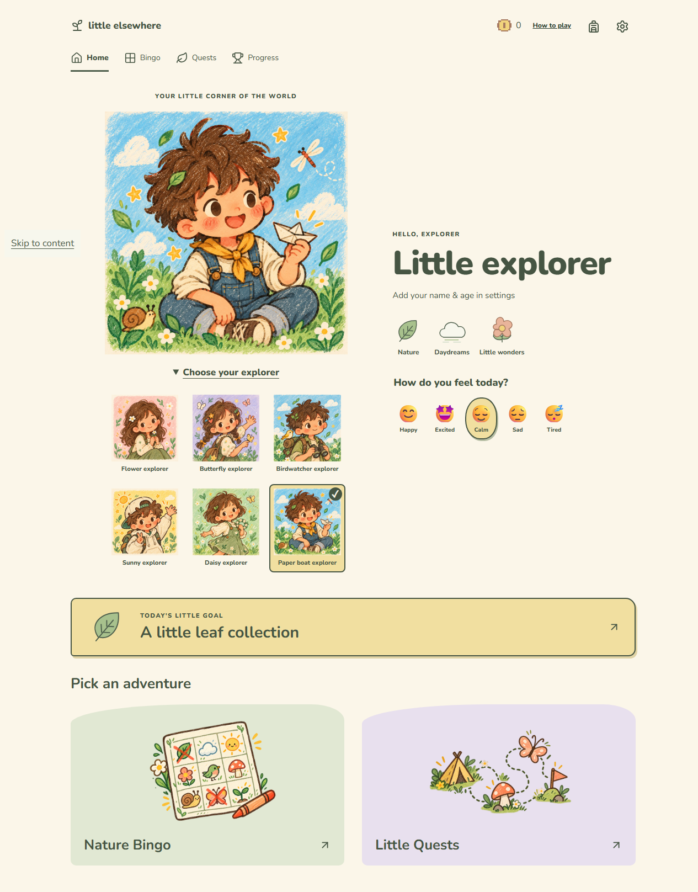
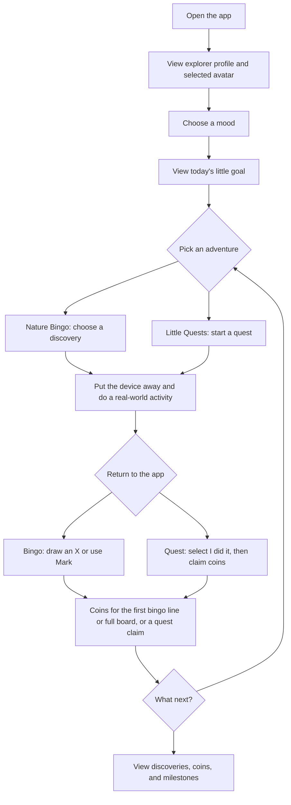
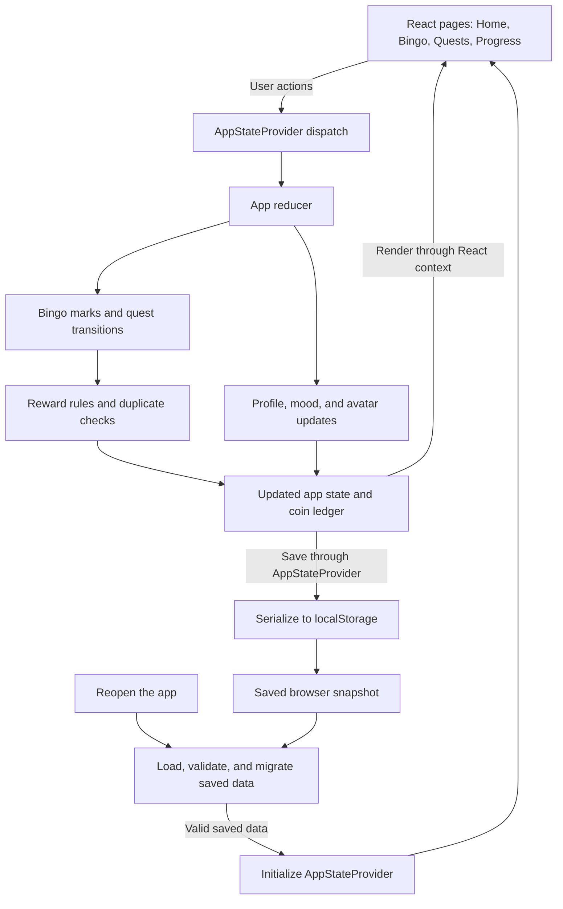

# Little Elsewhere

I'm building Little Elsewhere to make time away from a screen feel like a small adventure. Children choose something to explore, put the device away, then return to record their discoveries.

<p align="center">
  
</p>

## Why I built it

I wanted to give children a gentle reason to look around, move, create, and spend time with others. Small adventures, without streak penalties or pressure to keep playing.

## User journey



Mood selection is optional. Today's adventure prioritizes completed quests with unclaimed coins, then active quests, then available quests, and falls back to the current Bingo board when all quests are claimed. It does not reset daily. Bingo marks only earn coins when an eligible line or full board is completed.

## Features

- Explorer profile with an optional name and age, six selectable avatars, and five moods.
- A 3 by 3 Nature Bingo board with freehand X marks, a Mark button, undo, and confirmed board replacement.
- Eight Little Quests with indoor/adapted alternatives and separate start, complete, and claim steps.
- One-time coin rewards: 10 for the first bingo line, 20 more for the first full board, and 5–15 per quest. The current maximum is 105 coins per local profile.
- A recent adventure journal and backpack collection on Home, showing discoveries, completed quests, and three milestones. The compatible `#/progress` route shares these sections. Milestones acknowledge progress without extra coins.
- Local saves, first-time help, and warnings for failed saves, invalid data, or conflicting browser tabs.

Choose safe activities with a caregiver as needed. Progress is self-reported; the app encourages putting the device away and does not close, block, or control other apps.

## How it works



The diagrams describe implemented behavior. Saves stay in the same browser and device, with one shared local profile and no backend or account sync. Clearing site storage removes progress. Invalid saves require confirmed recovery; failed saves keep progress in memory and offer a retry.

## Tech stack

React, TypeScript, Vite, plain CSS, and Lucide icons. Nunito is loaded locally; retired Press Start 2P files and their license notice remain bundled. Tests use Vitest, React Testing Library, and jsdom. Exact versions are pinned in [package.json](package.json) and package-lock.json.

See [ARCHITECTURE.md](ARCHITECTURE.md) for the current folder map, module responsibilities, CSS ownership, and retained development resources.

## Setup and run

Requires Node.js `^24.15.0` or `>=26.0.0` and npm. [.nvmrc](.nvmrc) specifies the tested version, `24.16.0`.

```sh
npm ci
npm run dev
```

Open the URL printed by Vite, normally http://127.0.0.1:5173/. Stop the server with Ctrl+C.

```sh
npm run typecheck
npm test
npm run build
npm run preview
```

`npm run test:watch` runs tests in watch mode. The build command checks TypeScript and writes `dist/`; preview serves that build, normally at http://127.0.0.1:4173/. Both servers bind to loopback.

## Current status / future plans

This is a functional local MVP, and I'm still redesigning the interface. Home, Bingo, quests, profile choices, rewards, progress, and local persistence are implemented. Public deployment is not configured.

Future ideas include a virtual garden, seasonal activities, family-created quests, and a richer explorer journal with photos, notes, or drawings. These are not implemented or committed; the current journal displays recorded achievements. Coins currently cannot be spent; there is no shop or virtual world.

To refresh the banner, run `npm run dev`, open Home at a desktop width, dismiss welcome help, and capture the page using browser screenshot tools. Use the default profile or fictional details, then replace `public/screenshots/home-current.png` so the README path stays the same.

Before public release, broader accessibility and device checks, family feedback, and license selection remain. See [PRODUCT.md](PRODUCT.md) for the wider vision and [ASSETS.md](ASSETS.md) for artwork and license notices. A project license has not yet been selected.
