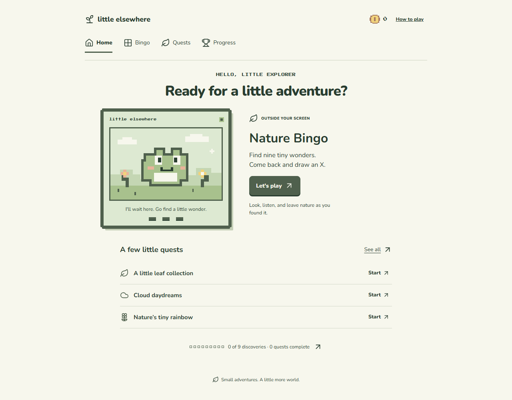
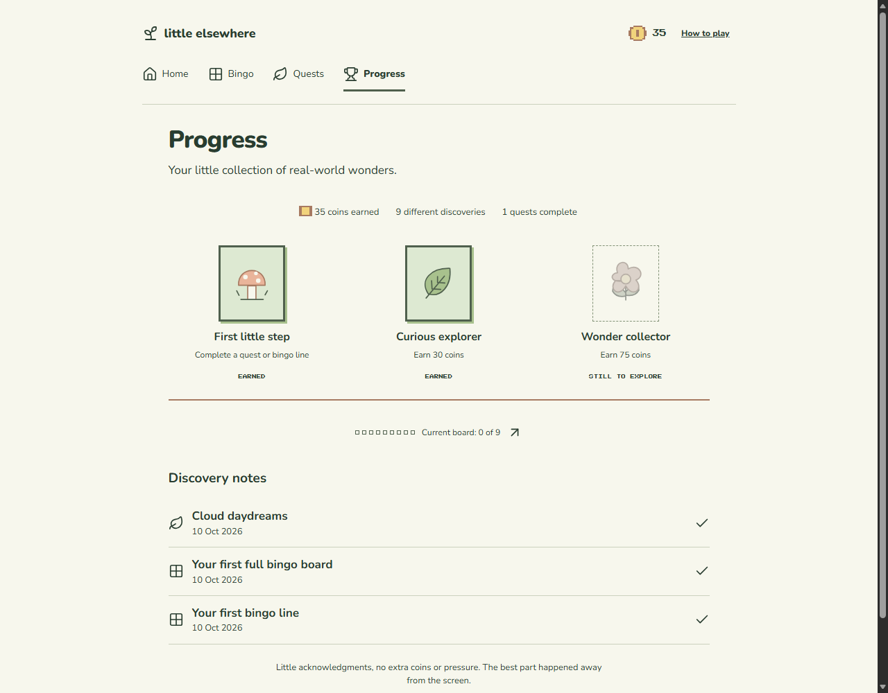

# Little Elsewhere

**Small adventures. A little more world.**

A child-friendly web app that makes stepping away from a screen feel like opening an adventure book. Choose an activity, put the device away, explore, then return to record discoveries and earn coins.

**Current status: functional local MVP with Visual Redesign V2 implemented.** Home, Nature Bingo, eight quests, coins, progress milestones, first-time help, and local persistence work. The interface uses a compact game HUD, matcha greens, warm ivory, local pixel typography, and an original static pixel frog. Future roadmap features remain unimplemented.

## Why it exists
Children and caregivers deserve playful invitations to observe, move, create, and spend time together, without guilt, pressure, streak penalties, or endless rewards.

## Implemented MVP features
- Illustrated 3×3 Nature Bingo with real freehand X marks, optional keyboard/button completion, completion feedback, and confirmed board replacement.
- Eight predefined quests with indoor/adapted alternatives.
- Finite coins with validated, duplicate-resistant awards.
- Home with a pixel pet scene, a prominent Bingo invitation, three short quest entries, and discovery dots; four consistent navigation views and first-time help.
- Validated local progress storage, recovery confirmation, save-failure warnings/retry, cross-tab conflict detection, responsive layouts, and accessible controls.

Coins are recognition, not money. Each quest pays once; bingo pays once for the first line and once for a full board across the local profile. Initial maximum: 105 coins. Progress milestones are static acknowledgments. No shop or virtual world exists.

## Screenshots
Actual browser captures from the local MVP (sample progress shown):






Mobile examples: [Home](public/screenshots/home-mobile.png), [Bingo](public/screenshots/bingo-mobile.png).

## Stack
React 19.3.0, TypeScript 7.0.2, Vite 8.3.4, plain CSS, and Lucide React 1.55.0 interface icons. Locally bundled Press Start 2P and Nunito fonts need no network font service. Vitest 5.0.3, React Testing Library, and jsdom verify navigation. Exact dependencies are pinned in package.json and package-lock.json. localStorage persists one validated snapshot. No backend, accounts, external APIs, or state library.

## Installation and development
Requires Node.js ^24.15.0 or >=26.0.0 and npm. Tested with Node 24.16.0 and npm 11.13.0; .nvmrc records the tested Node version. The higher minimum comes from the jsdom test environment; see the [Vite requirements](https://vite.dev/guide/) for the build tool baseline. From the project folder:

```sh
npm ci
npm run dev
npm run typecheck
npm run test
npm run build
npm run preview
```

Dependencies are already installed in this workspace. On a fresh checkout, run npm ci first. npm run dev normally serves http://127.0.0.1:5173/; use the URL printed by Vite if that port is occupied. Stop it with Ctrl+C. npm test runs the domain, navigation, persistence, and journey suites once; npm run test:watch starts watch mode. npm run build type-checks and writes dist/; npm run preview serves that build, normally at http://127.0.0.1:4173/. Development and preview servers bind to loopback only. Hosting/deployment is not configured.

## Try the app
Open Home, Bingo, Quests, and Progress using navigation (a bottom bar on mobile). Direct links such as #/quests work; unknown routes offer a return-home link. Draw two crossing diagonal strokes in a Bingo tile, or use its Mark button. Partial ink and completed X marks survive refresh. Clear ink removes unfinished drawing; Undo removes a completed mark without subtracting earned coins. Bingo detects rows, columns, diagonals, and full boards. Start a quest, put the device away, then complete and claim its coins. Claimed quests remain readable but cannot pay again. Active quests can be abandoned and restarted.

## How to play
1. A caregiver helps choose a safe adventure and explains the welcome.
2. Select Bingo or start a quest; put the device away while exploring.
3. Return to draw X marks on discoveries (or select Mark), or complete and claim a quest.
4. See earned coins and progress, then enjoy time away from the device.

Supervise as appropriate and use indoor/adapted options. Avoid handling unknown wildlife, tasting unidentified objects, or exploring unsafe places.

## Limitations
The MVP supports one shared explorer profile in one active browser tab. Progress is self-reported and browser/device-specific, cannot sync or prove activity, and is lost when site storage is cleared. It warns about failed saves and detected competing-tab changes; local records are editable and not an anti-cheat mechanism.

Offline adventures do not guarantee offline website loading. No service worker or installable app is planned. A web app cannot independently lock/unlock arbitrary apps such as YouTube. Genuine enforcement needs a separate platform feasibility/privacy investigation, OS permissions, and parental consent.

## Roadmap — future ideas, not implemented or committed
- Phase 2: Grow Your World — virtual garden/forest/world, plants, decorations, animals, environments, and earned cosmetics.
- Phase 3: Family Screen-Time Agreements — parent-controlled expectations before/after recreation or within routines, exceptions, and child-friendly explanations. Platform enforcement remains a separate investigation.
- Phase 4: Shared Adventures — private rooms, timers, shared goals, collective progress, privacy-conscious joining, and moderation.
- Phase 5: Explorer Journal — photographs, observations, drawings, notes, and potential identification integrations with reliable sources, uncertainty, guardian controls, and photo/location protection.
- Additional possibilities: seasonal/themed boards, rainy-day adventures, family-created quests, ability-specific activities, collectible companions, printable cards, and family dashboard.

All require separate approval and prioritization through feedback, safety, feasibility, and value.

## Privacy and child safety
Plan for no accounts, analytics, ads, photo/location collection, or application-level activity transmission. Store local activity progress and preferences only. Eventual hosting may process standard access logs; review hosting privacy separately before release. Use safe wording, caregiver guidance, accessible alternatives, and finite rewards. Future media, social, or enforcement features require separate privacy/safeguarding work.

## Contributing
Read [PRODUCT.md](PRODUCT.md), [RULES.md](RULES.md), [DESIGN.md](DESIGN.md), [ARCHITECTURE.md](ARCHITECTURE.md), and [TASKS.md](TASKS.md). Discuss dependencies/scope before implementation. Keep changes focused, preserve working code, include meaningful verification/accessibility checks, and update docs. Never include children's personal information in examples, screenshots, logs, or issues.

## License
**Not selected.** Choose a license and add LICENSE before public release. No open-source license grant is implied by this placeholder. Review asset and dependency licenses before release.
## Reward and storage details
The first bingo line grants 10 coins and the first full board grants 20 additional coins, once per local profile. Every newly completed line celebrates once per board. New-board confirmation clears marks and rearranges the same nine activities; coins, award keys, and found-activity history stay. Eight one-time quest rewards total 75 coins. Coins are derived from a ledger; initial maximum is 105. No spending or purchases exist. Home's “Today's little quests” is a spotlight, not a daily reset.

Progress shows distinct bingo activities ever found (maximum nine), current board marks, completed quests, coins, and three static milestones. Milestones do not pay coins or unlock a virtual world. Indoor/adapted activities have equal rewards; suggested times are not enforced.

Invalid local data pauses activities and offers an explicitly confirmed reset; it is never erased automatically. Failed writes keep current memory progress but warn that refresh may lose it. Retry saves the latest snapshot. Detected changes from another tab pause mutations and require confirmed reload; simultaneous multi-tab transactions are not guaranteed.

## Verification and release follow-up
On 2026-10-10, npm test passed 46 tests in five files and npm run build passed TypeScript checking and production bundling. Real Edge checks covered all views at 320/390/768/1280 CSS pixels, browser-simulated mouse/touch/pen drawing, bounded ink, canceled strokes, keyboard bingo activation, native dialogs, actual reload persistence, legacy-save upgrades, claims, duplicates, and recovery; final browser console had no errors. Screenshots are actual captures, not mockups.

Before public release, complete broader screen-reader/cross-browser and zoom checks, review activity wording with families, and select the license. No public deployment has been performed. Companion, nature illustrations, coin art, and favicon are original project artwork; interface icons use Lucide. Fonts are self-hosted. See [ASSETS.md](ASSETS.md) for sources and bundled license notices. Physical touch/stylus devices and a full screen-reader audit remain release follow-up.